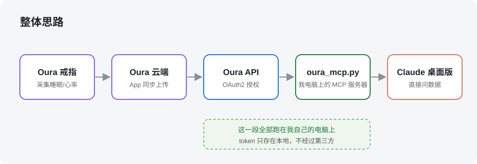
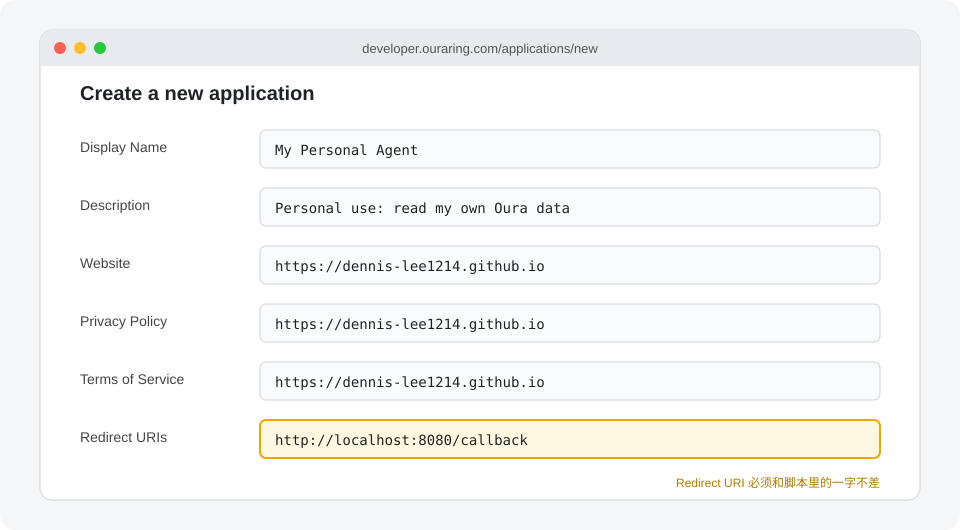
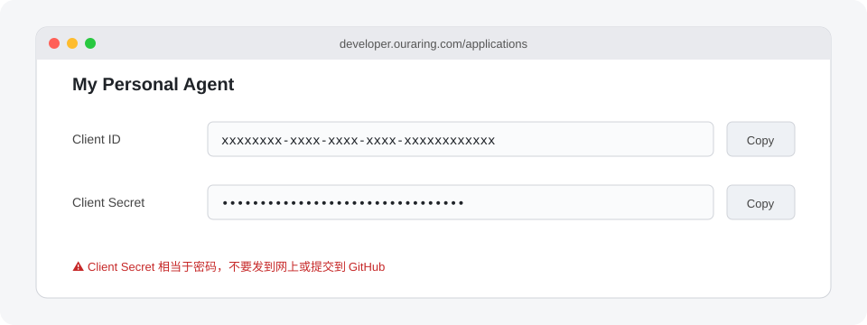
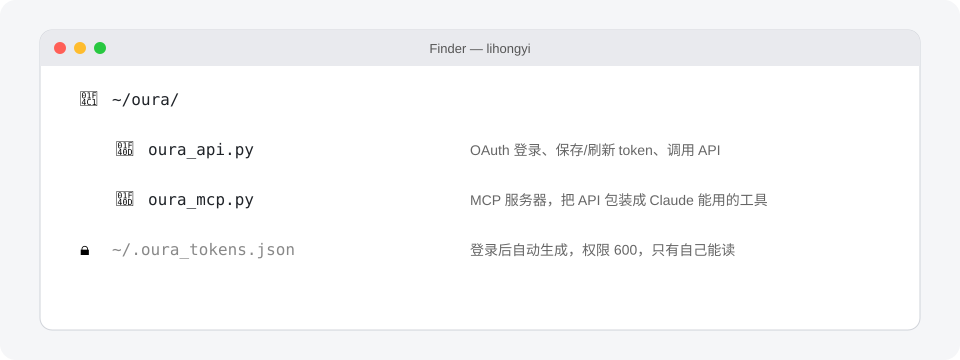
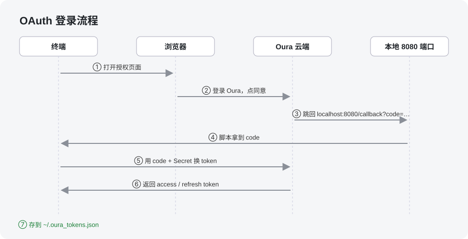
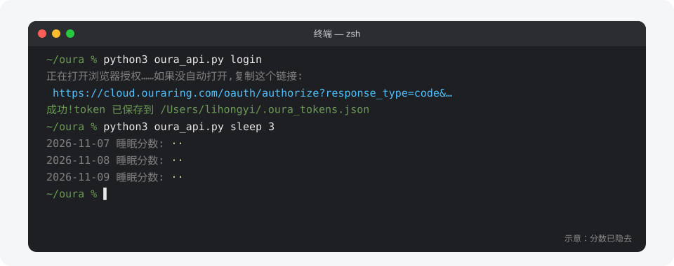
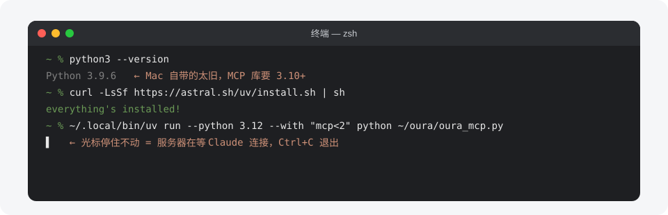
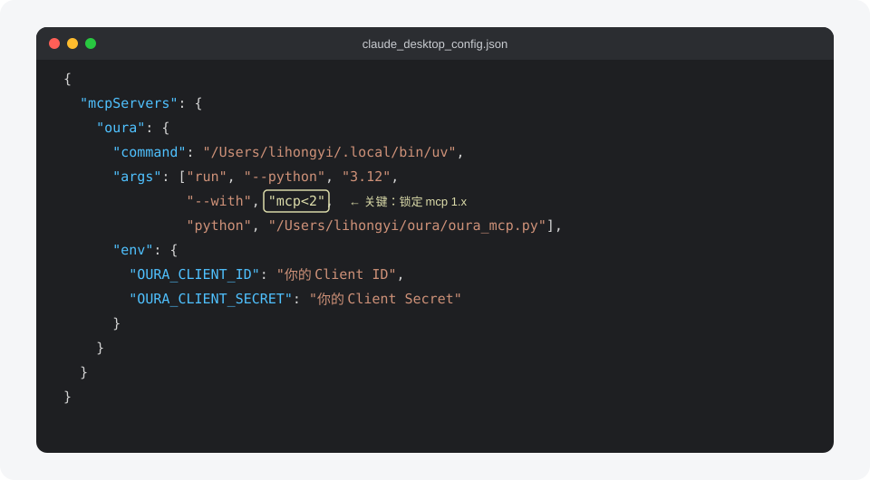
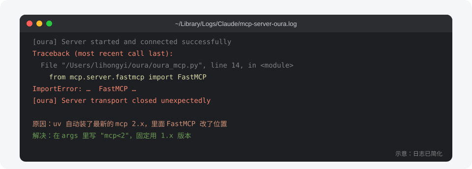
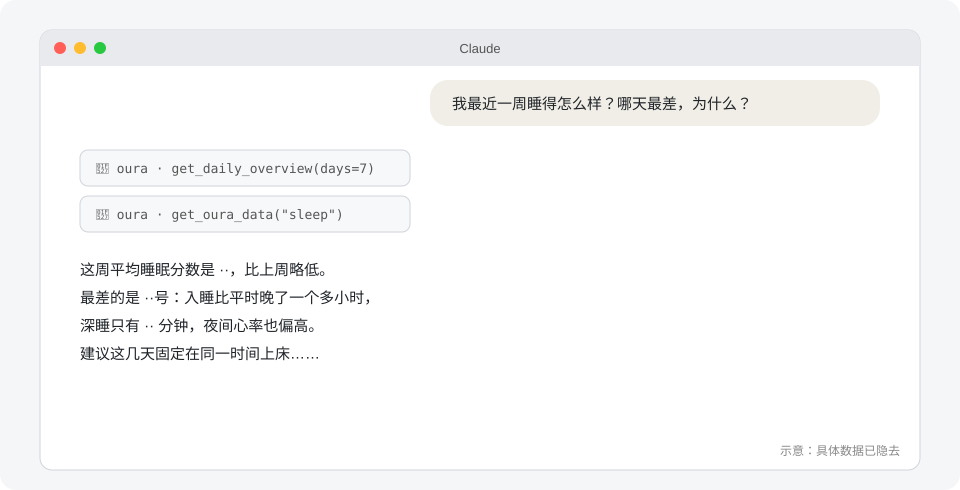

前几天开始戴 Oura 戒指。App 里的图表很好看，但我更想直接问："我这周睡得怎么样？哪天最差，为什么？"于是我把 Oura 的数据接进了 Claude 桌面版，让它变成一个能读我身体数据的个人 Agent。这篇记录一下完整流程和踩过的坑。

## 整体思路



数据从戒指同步到 Oura 云端，Oura 提供官方 API。我在自己电脑上跑一个小程序，用 OAuth 拿到授权后去调这个 API，再通过 **MCP**（Model Context Protocol）把它包装成 Claude 能调用的"工具"。这样 Claude 想看数据时，就会自己去调用，而 token 只存在我本地。

需要准备的：

- 一枚 Oura 戒指（Gen3 及以后的戒指需要有效的 Oura 会员才能用 API）
- 一台 Mac，装好 Claude 桌面版
- 一点终端基础

## 第一步：注册 Oura 开发者应用

以前 Oura 可以直接生成 Personal Access Token，现在已经取消了，改成必须注册一个应用走 OAuth2。不过个人用完全没门槛：用户少于 10 个的应用不需要 Oura 审核。

打开 developer.ouraring.com/applications，新建一个应用：



几个要点：

- **Redirect URI** 填 `http://localhost:8080/callback`，后面的脚本会在本地 8080 端口等授权回调，两边必须一字不差
- Website、Privacy Policy、Terms of Service 是必填项，个人用填自己的网站就行

## 第二步：拿到 Client ID 和 Client Secret

创建好之后，应用页面会显示两串字符：



**Client Secret 相当于密码**，只放在自己电脑上，不要发到网上，也不要提交到 GitHub。

## 第三步：准备两个脚本

我在用户目录下建了一个 `oura` 文件夹，放两个 Python 脚本：



- `oura_api.py`：负责 OAuth 登录、保存和自动刷新 token、调用 API，只用 Python 标准库
- `oura_mcp.py`：MCP 服务器，把 API 包装成几个工具给 Claude 用

`oura_api.py` 里的核心配置：

```python
REDIRECT_URI = "http://localhost:8080/callback"
SCOPES = "email personal daily heartrate workout tag session spo2"
AUTH_URL = "https://cloud.ouraring.com/oauth/authorize"
TOKEN_URL = "https://api.ouraring.com/oauth/token"
API_BASE = "https://api.ouraring.com/v2/usercollection"
TOKEN_FILE = os.path.expanduser("~/.oura_tokens.json")
```

`oura_mcp.py` 用 `FastMCP` 定义工具，比如这个"最近 N 天概览"：

```python
from mcp.server.fastmcp import FastMCP
mcp = FastMCP("oura")

@mcp.tool()
def get_daily_overview(days: int = 7) -> list:
    """最近 N 天的每日概览:睡眠、准备度、活动分数和步数。"""
    ...
```

一共暴露了四个工具：`list_data_types`（有哪些数据可查）、`get_personal_info`、`get_oura_data`（按类型和日期查，比如睡眠、准备度、HRV、压力）和 `get_daily_overview`。函数的说明文字很重要，Claude 就是靠它判断什么时候该用哪个工具。

## 第四步：OAuth 登录

第一次需要在浏览器里授权一次，流程是这样的：



脚本会临时在本地 8080 端口开一个小服务器，Oura 授权完会把 `code` 发回这里，脚本再用 `code` 加上 Client Secret 换成 access token 和 refresh token，存进 `~/.oura_tokens.json`（权限设成 600，只有自己能读）。之后 token 过期会自动用 refresh token 刷新，不用再登录。

终端里运行：



```bash
export OURA_CLIENT_ID=你的ClientID
export OURA_CLIENT_SECRET=你的ClientSecret
python3 ~/oura/oura_api.py login
python3 ~/oura/oura_api.py sleep 3   # 测试：打印最近 3 天睡眠分数
```

能打印出分数，就说明 API 已经通了。

## 第五步：安装 uv

MCP 的 Python 库需要 Python 3.10 以上，而 Mac 自带的 `python3` 是 3.9。我不想动系统的 Python，就用了 uv，它能临时下载指定版本的 Python 来跑脚本：



```bash
curl -LsSf https://astral.sh/uv/install.sh | sh
~/.local/bin/uv run --python 3.12 --with "mcp<2" python ~/oura/oura_mcp.py
```

运行后光标停住不动就是正常的，说明服务器在等 Claude 来连接，按 `Ctrl+C` 退出。注意 `"mcp<2"` 一定要加引号，不然 zsh 会把 `<` 当成重定向。

## 第六步：配置 Claude 桌面版

编辑 `~/Library/Application Support/Claude/claude_desktop_config.json`，加入 oura 服务器：



```json
{
  "mcpServers": {
    "oura": {
      "command": "/Users/你的用户名/.local/bin/uv",
      "args": ["run", "--python", "3.12", "--with", "mcp<2",
               "python", "/Users/你的用户名/oura/oura_mcp.py"],
      "env": {
        "OURA_CLIENT_ID": "你的 Client ID",
        "OURA_CLIENT_SECRET": "你的 Client Secret"
      }
    }
  }
}
```

小提醒：别用"文本编辑"直接改这个文件，它可能会把英文引号自动换成中文弯引号，JSON 就坏了。用 VS Code 改，或者用脚本写入更保险。路径要写完整的绝对路径，不能用 `~`。

## 踩坑：MCP 服务器一启动就崩

第一次重启 Claude 后，oura 显示连接失败。我一开始以为是 Python 版本问题，加了 `--python 3.12` 还是不行。后来去看日志 `~/Library/Logs/Claude/mcp-server-oura.log`，才发现真正的原因：



uv 每次会装**最新版**的 mcp 库，而 mcp 已经升级到 2.x，`FastMCP` 的导入方式变了，旧代码直接报错。解决办法就是在配置里写 `"mcp<2"`，固定用 1.x 版本。

经验：MCP 服务器出问题时，**先看日志**。

## 第七步：开始对话

完全退出 Claude（`Cmd + Q`）再打开，在工具菜单里能看到 oura，就可以直接问了：



Claude 会自己决定调用哪个工具、查哪几天，然后把数据整理成结论。我常问的几个问题：

- 我最近一周睡得怎么样？
- 对比一下我这周和上周的 HRV
- 我准备度最低的那几天，前一晚的睡眠有什么共同点？

## 最后

整个过程最花时间的不是写代码，而是搞清楚 OAuth 的流程和排查 MCP 的报错。接好之后，体验确实比在 App 里一张张翻图表好很多。

两点提醒：

- Client Secret 和 `~/.oura_tokens.json` 一定只留在本地
- Oura 的开发者协议对"把数据用于 AI 处理"有限制，自己看自己的数据问题不大，但如果打算做成产品给别人用，最好先读一下条款
